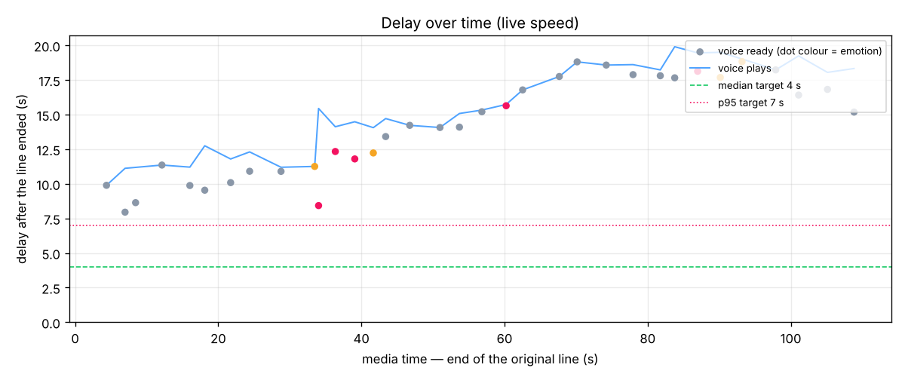

# Results report — 20261105-052952_synthetic_match_3spk_devtest

> ⚠️ **Not a live run** (speed 2.0). Numbers below are NOT live numbers.

## 1. Summary

- **Does the engine work live?** Not shown by this run — the clip was processed at speed 2.0 with no look-ahead; 33 lines were re-voiced and placed back in time; crashes: 0.
- **Median delay** (line ended → new voice ready): **14.22 s** (target ≤ 4.0 s) ❌
- **Worst delays:** p95 **18.67 s** (target ≤ 7.0 s) ❌, max 18.83 s; drift 0.0989 s/s ❌
- **Speaker accuracy:** **96.0 %** of speech time labelled with the right commentator (target ≥ 90 %) ✅
- **Word accuracy:** **90.1 %** (WER 9.9 %, target WER ≤ 12 %) ✅

## 2. Setup

| Item | Value |
|---|---|
| Clip | `data/clips/synthetic_match_3spk.mp4` (111.28 s) |
| Speed | **2.0** (development only) |
| Source | asr |
| Model: asr | faster_whisper:small.en (int8) |
| Model: speaker | ecapa |
| Model: tts | kokoro |
| Model load / warm-up | {'asr': 1.46, 'speaker': 2.14, 'tts': 4.83, 'warmup': 1.76} s |
| VM | 4 vCPU, CPU only |
| Max speakers | 3 |
| Enrollment | none (online clustering only) |
| Voices | {'S1': 'bm_george', 'S2': 'am_adam', 'S3': 'af_bella'} |
| Config hash | `fb922cd348fb` |
| Wall time | 62.48 s (live part 62.02 s) |

## 3. Delay

| Delay | p50 | p95 | max | n |
|---|---|---|---|---|
| Line end → voice ready | 14.22 | 18.67 | 18.83 | 33 |
| Line end → voice plays | 15.32 | 19.47 | 19.90 | 33 |

Stage breakdown (seconds, measured on the session clock):

| Stage | p50 | p95 | what it is |
|---|---|---|---|
| close_wait | 0.60 | 0.81 | end of speech → line closed (pause detection) |
| asr | 9.18 | 13.53 | line closed → text ready |
| speaker | 0.35 | 0.92 | line closed → speaker known |
| emotion | 9.18 | 13.53 | line closed → emotion known (needs text) |
| complete | 9.18 | 13.53 | line closed → all three ready |
| tts_queue | 0.00 | 0.00 | complete → TTS started (waiting for a worker) |
| tts | 4.65 | 6.20 | TTS synthesis time |
| schedule_wait | 0.98 | 3.19 | voice ready → voice plays (ordering, gaps) |

**Drift:** slope 0.0989 s/s → the delay builds up over time; extrapolated delay after 10 min: 68.11 s.

Schedule actions: {'speedup': 33, 'dropped': 3}. Lines with errors: 0.

## 4. Accuracy

| Measure | Result | Target |
|---|---|---|
| Word error rate | **9.9 %** (sub 21, del 6, ins 3) | ≤ 12 % ✅ |
| Speaker accuracy (time) | **96.0 %** | ≥ 90 % ✅ |
| Speaker accuracy (lines) | 97.2 % | — |
| Speakers found / in truth | 3 / 3 (mapping {'S1': 'A', 'S2': 'B', 'S3': 'C'}) | — |
| Emotion agreement (exact) | 69.4 % | — |
| Emotion agreement (within one step) | 100.0 % | ≥ 80 % |
| Peak moments detected | 6 / 7 | all |
| Lines out / truth | 36 / 36 (ratio 1.0) | ≈ 1.0 |
| Line boundaries inside a truth line | 13 | low |
| Short shouts on their own line | 1 / 3 | — |
| Coverage (truth speech re-voiced) | 90.5 % | — |

Emotion confusion (rows = truth, columns = engine):

| truth \ engine | calm | neutral | excited | peak |
|---|---|---|---|---|
| calm | 0 | 8 | 0 | 0 |
| neutral | 0 | 15 | 0 | 0 |
| excited | 0 | 2 | 4 | 0 |
| peak | 0 | 0 | 1 | 6 |

## 5. Voice quality

Automatic checks:

- TTS duration ÷ original line duration: p50 1.29, p95 1.74; lines over 1.6× (voice too slow to keep up): 4
- Files with clipping: 0 / 34 (max peak -2.98 dBFS)
- Files with an internal silence > 400 ms: 0
- Ducking: original commentary -12.04 dB while a voice plays vs 0.0 dB elsewhere → depth **12.04 dB** (target ≥ 9 dB)

Human listen-test (open `voices_only.wav` and `demo_live.mp4`, tick each box):

- [ ] Voices sound natural (no robotic or metallic artefacts)
- [ ] Excited / peak moments sound more energetic than calm ones
- [ ] Player and team names are pronounced correctly
- [ ] No clipped or cut-off words at the start or end of lines
- [ ] Each commentator keeps the same character voice throughout
- [ ] Original commentary is clearly turned down under the new voice; crowd sound stays

## 6. What worked well / what needs improving

**Worked well**

- Words are recognised accurately (WER 9.9 %).
- Commentators are told apart reliably.
- Emotion within one step of the truth on 100 % of lines.
- No generated line clips.

**Needs improving**

- Median delay 14.222 s is above the 4.0 s target.
- Worst-case (p95) delay 18.669 s is above 7.0 s.
- Delay builds up over the clip — the pipeline is slower than real time.
- Only 6/7 peak moments were labelled peak.
- 4 voice lines are > 1.6× longer than the original.

## 7. Recommendations

- ASR p95 is 13.53 s: switch to `base.en` or lower `max_line_s` (docs/04 levers).
- TTS p95 is 6.198 s: reduce CPU contention (torch threads) or use more workers.
- *Expectation, not measured:* paid streaming ASR with end-of-turn detection and a faster hosted TTS would cut the delay roughly in half (docs/12).

## 8. Files

- [demo_live.mp4](demo_live.mp4) — what a viewer would hear live (voices at their measured delay)
- [demo_synced.mp4](demo_synced.mp4) — synced-mode preview (picture held back by D)
- [voices_only.wav](voices_only.wav) — generated voices only (for judging voice quality)
- [record.json](record.json) — the full live record
- [lines.csv](lines.csv) — delay log, one row per line
- [metrics.json](metrics.json) — all computed metrics
- [delay_over_time.png](delay_over_time.png) — delay chart

Warnings during the run (2): delay drift 0.083 s/s at t=60 s; delay drift 0.100 s/s at t=124 s
