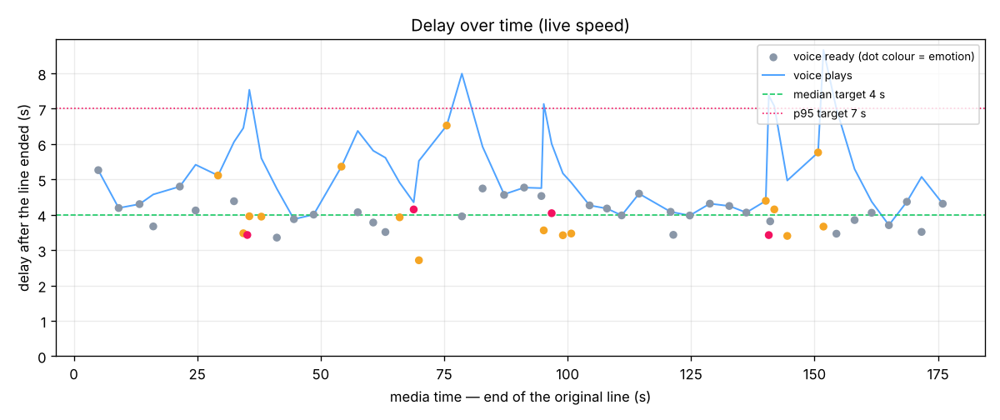

# Results report — 20261105-105030_synthetic_match_fish1

## 1. Summary

- **Does the engine work live?** Yes — the clip was processed at speed 1.0 with no look-ahead; 54 lines were re-voiced and placed back in time; crashes: 0.
- **Median delay** (line ended → new voice ready): **4.06 s** (target ≤ 4.0 s) ❌
- **Worst delays:** p95 **5.30 s** (target ≤ 7.0 s) ✅, max 6.52 s; drift -0.0014 s/s ✅
- **Speaker accuracy:** **92.9 %** of speech time labelled with the right commentator (target ≥ 90 %) ✅
- **Word accuracy:** **89.3 %** (WER 10.7 %, target WER ≤ 12 %) ✅

## 2. Setup

| Item | Value |
|---|---|
| Clip | `data/clips/synthetic_match.mp4` (178.36 s) |
| Speed | **1.0** (live, honest) |
| Source | asr |
| Model: torch_threads | 4 |
| Model: asr | faster_whisper:small.en (int8, 4 threads) |
| Model: speaker | ecapa |
| Model: tts | fish:s2.1-pro-free (balanced) |
| Model load / warm-up | {'asr': 1.68, 'speaker': 3.03, 'tts': 8.03, 'warmup': 23.23} s |
| VM | 4 vCPU, CPU only |
| Max speakers | 2 |
| Enrollment | none (online clustering only) |
| Voices | {'S1': 'bm_george', 'S2': 'am_adam', 'S3': 'af_bella'} |
| Config hash | `bdbc4018197b` |
| Wall time | 181.1 s (live part 180.29 s) |

## 3. Delay

| Delay | p50 | p95 | max | n |
|---|---|---|---|---|
| Line end → voice ready | 4.06 | 5.30 | 6.52 | 54 |
| Line end → voice plays | 4.94 | 7.43 | 8.66 | 54 |

Stage breakdown (seconds, measured on the session clock):

| Stage | p50 | p95 | what it is |
|---|---|---|---|
| close_wait | 0.49 | 0.59 | end of speech → line closed (pause detection) |
| asr | 1.32 | 2.31 | line closed → text ready |
| speaker | 0.21 | 0.61 | line closed → speaker known |
| emotion | 1.32 | 2.32 | line closed → emotion known (needs text) |
| complete | 1.32 | 2.32 | line closed → all three ready |
| tts_queue | 0.00 | 0.00 | complete → TTS started (waiting for a worker) |
| tts | 2.26 | 3.08 | TTS synthesis time |
| schedule_wait | 0.27 | 3.74 | voice ready → voice plays (ordering, gaps) |

**Drift:** slope -0.0014 s/s → no drift — the delay does not build up; extrapolated delay after 10 min: 3.44 s.

Schedule actions: {'speedup': 54, 'dropped': 2}. Lines with errors: 0.

## 4. Accuracy

| Measure | Result | Target |
|---|---|---|
| Word error rate | **10.7 %** (sub 39, del 13, ins 4) | ≤ 12 % ✅ |
| Speaker accuracy (time) | **92.9 %** | ≥ 90 % ✅ |
| Speaker accuracy (lines) | 96.4 % | — |
| Speakers found / in truth | 2 / 2 (mapping {'S1': 'A', 'S2': 'B'}) | — |
| Emotion agreement (exact) | 59.7 % | — |
| Emotion agreement (within one step) | 96.8 % | ≥ 80 % |
| Peak moments detected | 6 / 10 | all |
| Lines out / truth | 56 / 62 (ratio 0.903) | ≈ 1.0 |
| Line boundaries inside a truth line | 14 | low |
| Short shouts on their own line | 3 / 5 | — |
| Coverage (truth speech re-voiced) | 98.2 % | — |

Emotion confusion (rows = truth, columns = engine):

| truth \ engine | calm | neutral | excited | peak |
|---|---|---|---|---|
| calm | 0 | 14 | 1 | 0 |
| neutral | 0 | 22 | 2 | 0 |
| excited | 0 | 3 | 10 | 0 |
| peak | 0 | 1 | 4 | 5 |

## 5. Voice quality

Automatic checks:

- TTS duration ÷ original line duration: p50 0.92, p95 1.72; lines over 1.6× (voice too slow to keep up): 4
- Files with clipping: 0 / 56 (max peak -3.47 dBFS)
- Files with an internal silence > 400 ms: 0
- Ducking: original commentary -12.04 dB while a voice plays vs 0.0 dB elsewhere → depth **12.04 dB** (target ≥ 9 dB)

Human listen-test (open `voices_only.wav` and `demo_live.mp4`, tick each box):

- [ ] Voices sound natural (no robotic or metallic artefacts)
- [ ] Excited / peak moments sound more energetic than calm ones
- [ ] Player and team names are pronounced correctly
- [ ] No clipped or cut-off words at the start or end of lines
- [ ] Each commentator keeps the same character voice throughout
- [ ] Original commentary is clearly turned down under the new voice; crowd sound stays

## 6. What worked well / what needs improving

**Worked well**

- Delay does not build up over the clip (drift ≈ 0).
- Words are recognised accurately (WER 10.7 %).
- Commentators are told apart reliably.
- Emotion within one step of the truth on 97 % of lines.
- No generated line clips.

**Needs improving**

- Median delay 4.059 s is above the 4.0 s target.
- Only 6/10 peak moments were labelled peak.
- 4 voice lines are > 1.6× longer than the original.

## 7. Recommendations

- ASR p95 is 2.315 s: switch to `base.en` or lower `max_line_s` (docs/04 levers).
- TTS p95 is 3.08 s: reduce CPU contention (torch threads) or use more workers.
- *Expectation, not measured:* paid streaming ASR with end-of-turn detection and a faster hosted TTS would cut the delay roughly in half (docs/12).

## 8. Files

- [demo_live.mp4](demo_live.mp4) — what a viewer would hear live (voices at their measured delay)
- [demo_synced.mp4](demo_synced.mp4) — synced-mode preview (picture held back by D)
- [voices_only.wav](voices_only.wav) — generated voices only (for judging voice quality)
- [record.json](record.json) — the full live record
- [lines.csv](lines.csv) — delay log, one row per line
- [metrics.json](metrics.json) — all computed metrics
- [delay_over_time.png](delay_over_time.png) — delay chart
