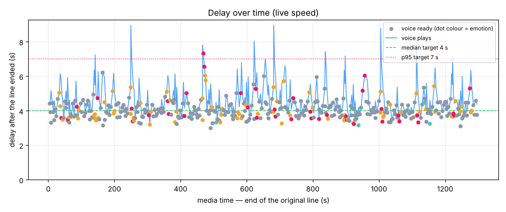

# Results report — 20261105-073936_ad1b3c

## 1. Summary

- **Does the engine work live?** Yes — the clip was processed at speed 1.0 with no look-ahead; 386 lines were re-voiced and placed back in time; crashes: 0.
- **Median delay** (line ended → new voice ready): **3.93 s** (target ≤ 4.0 s) ✅
- **Worst delays:** p95 **5.11 s** (target ≤ 7.0 s) ✅, max 7.33 s; drift -0.0000 s/s ✅
- **Speaker accuracy:** **93.5 %** of speech time labelled with the right commentator (target ≥ 90 %) ✅
- **Word accuracy:** **90.0 %** (WER 10.0 %, target WER ≤ 12 %) ✅

## 2. Setup

| Item | Value |
|---|---|
| Clip | `/home/user/sd/live-character-voice/data/clips/synthetic_match_20min.mp4` (1299.03 s) |
| Speed | **1.0** (live, honest) |
| Source | asr |
| Model: torch_threads | 4 |
| Model: asr | faster_whisper:small.en (int8, 4 threads) |
| Model: speaker | ecapa |
| Model: tts | kokoro |
| Model load / warm-up | {'asr': 1.39, 'speaker': 1.19, 'tts': 4.98, 'warmup': 8.46} s |
| VM | 4 vCPU, CPU only |
| Max speakers | 3 |
| Enrollment | none (online clustering only) |
| Voices | {'S1': 'am_michael', 'S2': 'am_adam', 'S3': 'af_bella'} |
| Config hash | `93922eaf484e` |
| Wall time | 1305.17 s (live part 1300.32 s) |

## 3. Delay

| Delay | p50 | p95 | max | n |
|---|---|---|---|---|
| Line end → voice ready | 3.93 | 5.11 | 7.33 | 386 |
| Line end → voice plays | 4.40 | 6.47 | 8.97 | 386 |

Stage breakdown (seconds, measured on the session clock):

| Stage | p50 | p95 | what it is |
|---|---|---|---|
| close_wait | 0.47 | 0.60 | end of speech → line closed (pause detection) |
| asr | 1.39 | 1.79 | line closed → text ready |
| speaker | 0.24 | 0.44 | line closed → speaker known |
| emotion | 1.39 | 1.79 | line closed → emotion known (needs text) |
| complete | 1.39 | 1.79 | line closed → all three ready |
| tts_queue | 0.00 | 0.00 | complete → TTS started (waiting for a worker) |
| tts | 2.05 | 3.01 | TTS synthesis time |
| schedule_wait | 0.00 | 2.61 | voice ready → voice plays (ordering, gaps) |

**Drift:** slope -0.0000 s/s → no drift — the delay does not build up; extrapolated delay after 10 min: 4.05 s.

Schedule actions: {'speedup': 382, 'dropped': 10, 'none': 4}. Lines with errors: 0.

## 4. Accuracy

| Measure | Result | Target |
|---|---|---|
| Word error rate | **10.0 %** (sub 268, del 69, ins 27) | ≤ 12 % ✅ |
| Speaker accuracy (time) | **93.5 %** | ≥ 90 % ✅ |
| Speaker accuracy (lines) | 96.2 % | — |
| Speakers found / in truth | 3 / 3 (mapping {'S1': 'A', 'S2': 'B', 'S3': 'C'}) | — |
| Emotion agreement (exact) | 60.9 % | — |
| Emotion agreement (within one step) | 99.5 % | ≥ 80 % |
| Peak moments detected | 57 / 84 | all |
| Lines out / truth | 396 / 432 (ratio 0.917) | ≈ 1.0 |
| Line boundaries inside a truth line | 150 | low |
| Short shouts on their own line | 8 / 36 | — |
| Coverage (truth speech re-voiced) | 93.3 % | — |

Emotion confusion (rows = truth, columns = engine):

| truth \ engine | calm | neutral | excited | peak |
|---|---|---|---|---|
| calm | 0 | 96 | 0 | 0 |
| neutral | 1 | 164 | 13 | 2 |
| excited | 0 | 17 | 46 | 9 |
| peak | 0 | 0 | 31 | 53 |

## 5. Voice quality

Automatic checks:

- TTS duration ÷ original line duration: p50 0.95, p95 1.15; lines over 1.6× (voice too slow to keep up): 7
- Files with clipping: 0 / 396 (max peak -1.16 dBFS)
- Files with an internal silence > 400 ms: 4

Human listen-test (open `voices_only.wav` and `demo_live.mp4`, tick each box):

- [ ] Voices sound natural (no robotic or metallic artefacts)
- [ ] Excited / peak moments sound more energetic than calm ones
- [ ] Player and team names are pronounced correctly
- [ ] No clipped or cut-off words at the start or end of lines
- [ ] Each commentator keeps the same character voice throughout
- [ ] Original commentary is clearly turned down under the new voice; crowd sound stays

## 6. What worked well / what needs improving

**Worked well**

- Median delay 3.932 s is inside the 4.0 s target.
- Delay does not build up over the clip (drift ≈ 0).
- Words are recognised accurately (WER 10.0 %).
- Commentators are told apart reliably.
- Emotion within one step of the truth on 100 % of lines.
- No generated line clips.

**Needs improving**

- Only 57/84 peak moments were labelled peak.
- 7 voice lines are > 1.6× longer than the original.

## 7. Recommendations

- ASR p95 is 1.794 s: switch to `base.en` or lower `max_line_s` (docs/04 levers).
- TTS p95 is 3.006 s: reduce CPU contention (torch threads) or use more workers.
- *Expectation, not measured:* paid streaming ASR with end-of-turn detection and a faster hosted TTS would cut the delay roughly in half (docs/12).

## 8. Files

- [record.json](record.json) — the full live record
- [lines.csv](lines.csv) — delay log, one row per line
- [metrics.json](metrics.json) — all computed metrics
- [delay_over_time.png](delay_over_time.png) — delay chart
